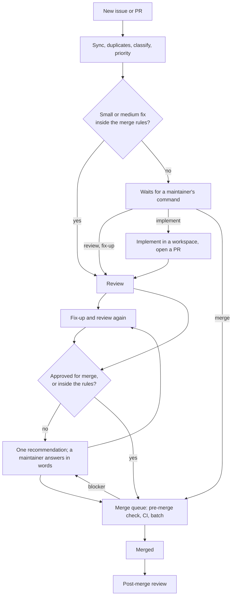

# AutoCraft

AutoCraft is a model harness for maintaining GitHub repositories with a large backlog. It mirrors every issue and PR into a local database and runs a pipeline of model steps over them. Jev classifiers and Claude Haiku, Sonnet and Opus classify, prioritise, find duplicates, review, write fixes, implement issues, verify and merge. Maintainers start items and answer one recommendation each.

The models' tools are a fixed set of GitHub actions (comments, labels, branches, PRs, merges), all behind one write module and `safe-merge`-style checks. Actions run automatically where the rules say they are safe. Otherwise a model proposes and a person accepts. Each issue and PR has its own conversation between Opus and a maintainer, with action cards the maintainer can run. The pipeline is built around maintainers' judgement, which is the limited resource, not around token cost.

Originally written for the [storytold](https://github.com/storytold) craft apps, AutoCraft can also track repositories owned by other GitHub organizations or users via `autocraft-server repos track owner/name` without requiring source edits. See [Track repos and sync](#track-repos-and-sync) for naming and GitHub App sync limitations.

## How it works

Stages run in this order. Details, limits and rules for each are in [docs/pipeline.md](docs/pipeline.md).

<!-- stages:begin stage-table (generated by npm run docs; do not edit) -->
| Stage | What it does | Model | Stops for a person |
|---|---|---|---|
| Sync | Mirrors every issue, PR and comment of the tracked repos into the local database, from GitHub App webhooks within seconds and from a backstop poll, reads the CI state of each default branch every 2 minutes, and makes a vector of each item's title and body for similar-item search. | Local embedding model | no |
| Duplicates | Finds items that describe the same bug or request as another open item, or one closed in the last year, and compares each group. A duplicate is a signal on the items; it closes nothing and holds back only a pull request nobody started. | Jev, Haiku, Opus, Sonnet | no |
| Classify | Gives each open item one type label and two flags (security, needs decision). Jev goes first, Haiku gives a second opinion, and a referee settles disagreements outside the scope labels. | Jev, Haiku, Sonnet, Opus | no |
| Priority | Gives each open item a level from P0 to P4, then orders the candidates of later stages by a work rank. | Jev, Haiku | no |
| Conversations | Answers what a maintainer or operator writes in an item's conversation; a reply may propose commands that a person runs with a button. | Opus | yes: a person runs the commands a reply proposes |
| Label | Writes each settled type label and flag to GitHub. A label a person set is never changed. | none | yes: per-repo approval |
| Review | Opus reviews every wanted PR at its current head, reading the repo, and gives a verdict with the complete fix list. It writes nothing to GitHub until the final review is posted. | Opus | yes: hold and close verdicts, every review of an item not approved for merge, and every issue review: one recommendation to answer |
| Implement | Implements an issue a maintainer queued: Opus plans it in a workspace pod and asks the author or a maintainer when the issue leaves facts or choices open, then writes the change and its tests in a workspace session; AutoCraft runs the formatter, clippy and the tests itself, sends findings back to the session and opens the pull request. A review that asks for fixes or red CI on that pull request goes back to the same session, and AutoCraft pushes the checked revision for a new review. | Opus | yes: starting an issue, questions the plan leaves open, stuck implementations |
| Fix-up | For a take-with-fixes review, applies the listed small fixes to the contributor's branch, or posts them as a comment when the branch cannot be pushed to (on a PR approved for merge, its approver is asked instead). For a wanted PR whose gate check fails, runs the formatter, reruns an infrastructure failure once, or has a model patch the code. For a red default branch in an approved repo, reruns a flaky failure once, opens an issue for an infrastructure failure and a fix PR for a code failure. | Sonnet, Opus, Haiku | yes: per-repo approval |
| Verify | Records upstream CI as the verification of taken PRs in repos that have it. A repo without CI, and a bugfix that changes a test file, get a model-planned build in a build environment; a model summarises failures. With the Screenshots feature on, a UI pull request is also rendered at the base and at the head, and a model compares the images; a clear regression holds the merge. | Sonnet, Haiku, Opus | yes: failures and errors: a blocker to answer |
| Merge queue | Merges PRs that pass the rules in integration batches (up to 50 PRs, checked by upstream CI on the batch PR) through safe-merge; a PR outside the rules merges once a maintainer approves it. Before a PR the rule would merge goes into a batch, and before a pre-approved merge is handed over to the queue, Opus reviews its head commit once more, adversarially and independently of the first review; a defect it verifies becomes a fix-up, or brings an approved item back to a maintainer. Approves held CI runs of outside contributors where the repo allows it. | Opus | yes: approval to merge, for PRs outside the rules |
| Act | Carries out the closes people command, as them, with a short comment from a fixed template, and posts the comment that asks a pull request's author for more work. | none | yes: per-repo approval |
| Post-merge review | Opus reviews what landed with a merge nobody approved, or whose code the pipeline changed after the approval, reading it with the pipeline's own commits and reviews of the PR, and lists defects and minor findings; a PR that merged as a person approved it gets no such review. Each defect that no open item covers becomes one follow-up issue in repos approved for commenting, except on a security fix whose advisory is not published yet (its findings are only shown); minor findings are only shown. Once an hour, while an operator has named an eval repo, the self-evaluation looks for stalls, loops, repeated failures and cost outliers in AutoCraft's own records; Opus investigates each new or grown cause in the eval repo's code, and each real defect becomes one issue there. | Opus | yes: per-repo approval |
<!-- stages:end stage-table -->



### Trust boundaries

- Untrusted code runs only in a separate build environment (a worker as another OS user, with rootless Podman), never where GitHub or Claude credentials are.
- Model calls that use tools run inside a bubblewrap sandbox. They get `Read`, `Grep` and `Glob` on read-only checkouts of the public tracked repos, a Haiku explorer subagent, and read-only item tools (search, item, similar items, PR diff) over a snapshot of the public items. Other calls run without tools.
- Only `src/github/write.ts` writes to GitHub. Every write is recorded in an audit table, and a test fails if another file writes.
- A person's command is its own approval of the merge, pushes or close it asks for, for that item alone. Every other GitHub write needs the repo's approval of its kind (merges and pushes of work nobody started, comments, labels and others). An operator, or a maintainer with write access to the repo, gives it on the dashboard; it cannot be set from the CLI.
- The dashboard needs GitHub sign-in. A `maintainer` starts, answers, approves and holds any item, and sets the approvals and the pipeline switch, of the repos they have GitHub write access to. An `operator` does so everywhere and keeps the instance's settings: access, the global switch and limits, prompts, build environments and the GitHub identity. A `viewer` reads.
- Contributors' own agents reach AutoCraft through an MCP server on the dashboard (`POST /mcp`) with a personal token. They act as their user, with that user's role and repo access, and send the same commands the user can send on GitHub or the dashboard.
- A pipeline switch (on/off) turns the whole pipeline off, a per-repo pipeline switch limits it to chosen repos, and each step has a daily limit.

See [Trust boundary](docs/pipeline.md#trust-boundary).

### Dashboard browsing

Items is one filterable list; a row's details open inline under it. Home lists the reader's own items and marks those with a question for them. The item page is a chat with AutoCraft, with the GitHub and Events tabs beside it. [The UI design](docs/ui-design.md) describes the layouts and filters.

## Setup

### Requirements

| Needed | Used for |
|---|---|
| Node 24 or later (`engines` in `package.json`), pnpm | Runs the TypeScript directly; SQLite through the built-in `node:sqlite` |
| `gh`, logged in | Sync (`gh api graphql`) and every GitHub write |
| `git` | Clones, diffs and pushes |
| `claude` (Claude Code CLI) | All Claude calls |
| `bwrap` (bubblewrap, `/usr/bin/bwrap`) | Sandbox for a local Claude call. Model calls run on Task Runners, which sandbox them on their own machines: a call gets its checkout and tools whenever the checkout can be built, whether or not the server has bubblewrap or sets `AUTOCRAFT_NO_SANDBOX=1` |
| `jev` (optional) | CLI for TypeSafe's Jev model, used by the classify, priority and duplicate steps (`jev --compact ask`). Without it, switched off (`autocraft-server inference jev off`), or when its account is out of credit or its key is rejected, Haiku does Jev's work through the Task Runners (more Claude usage) |
| Podman and a second OS user | Build environments for Verify and Implement (optional) |
| `sqlite3`, `curl` | `deploy/backup.sh` and `deploy/hook.sh` |

### Install

```sh
git clone https://github.com/storytold/autocraft.git
cd autocraft
pnpm install
pnpm -C web install && pnpm -C web build    # writes web/dist
node src/cli.ts                             # lists every command
```

`autocraft` is the `bin` of `package.json`; `node src/cli.ts <command>` runs the same program. The database is `$AUTOCRAFT_DB`, default `~/.local/share/autocraft/mirror.db`.

### GitHub access

`gh` needs an account with read access to the tracked repos for Sync. The same account writes (labels, comments, closes, pushes, merges) in the repos an operator approves, so it needs write access there.

### Dashboard sign-in (GitHub OAuth App)

Create an OAuth App on GitHub:

- Homepage URL: your dashboard origin, for example `https://autocraft.example.com`.
- Authorization callback URL: `https://autocraft.example.com/auth/callback`. It must equal `<AUTOCRAFT_BASE_URL>/auth/callback` exactly.
- No scopes are requested. Expiring user tokens are supported.

Write the client ID, client secret and a random session key (at least 32 characters) to a JSON file with mode 0600:

```json
{ "github_client_id": "...", "github_client_secret": "...", "session_key": "..." }
```

Point `AUTOCRAFT_SECRETS_FILE` at it. The server refuses to start if the file is missing, incomplete, or readable by group or others.

To sign in through a GitHub App instead, register it from the dashboard's GitHub App page (operators only). The dashboard stores the app's keys in the database, sealed with a key derived from the file's `session_key`; the file itself is only read. Then choose "GitHub App" as the GitHub identity on the same page; it is refused unless the app covers every tracked repo. `AUTOCRAFT_GITHUB_APP_NAME` sets the name the registration form suggests. With the app's webhooks on, anyone who may use Queue items on the merge queue page can add a pull request or issue to the merge queue from GitHub by commenting `@<app-slug> merge queue` on it; the app answers in the thread (docs/operations.md, Webhooks). The same people can comment `@<app-slug> autorepin <owner/name#number>` on a pull request that pins another tracked repository's crates to an unmerged pull request: once that pull request is merged, AutoCraft pushes a commit that repins them to its merge commit, or with `via <branch>` after it, to the first commit of that branch that contains it (docs/operations.md, Autorepin).

| Variable | Meaning |
|---|---|
| `AUTOCRAFT_BASE_URL` | Public origin of the dashboard, no path |
| `AUTOCRAFT_LISTEN` | `host:port`, default `127.0.0.1:8993` |
| `AUTOCRAFT_DB` | Database path |
| `AUTOCRAFT_DB_URL` | A `postgres://` URL, to use Postgres instead of the SQLite file |
| `AUTOCRAFT_SECRETS_FILE` | The secrets file above |
| `AUTOCRAFT_GITHUB_APP_NAME` | App name suggested on the registration form, default `AutoCraft` |
| `AUTOCRAFT_WEB_DIST` | Built frontend, default `web/dist` |
| `AUTOCRAFT_TRUST_PROXY` | The number of proxies in front that set `X-Forwarded-For` (`1` behind one proxy) |

The server speaks plain HTTP; put a reverse proxy with HTTPS in front. More variables are in [docs/operations.md](docs/operations.md).

### Model calls

Claude calls run on Task Runners, never on this host (see [Model calls on maintainers' machines](#model-calls-on-maintainers-machines)). Jev and embeddings run here:

```sh
autocraft-server inference jev 4        # parallel Jev calls
autocraft-server inference jev off      # Haiku does Jev's work; `on` switches Jev back on
```

See [Agent runs](docs/pipeline.md#agent-runs).

### Track repos and sync

```sh
autocraft-server repos track <name>        # a new bare name defaults to storytold
autocraft-server repos track <owner/name>  # a repository owned by another organization or user
autocraft-server repos list
autocraft-server sync                   # first sync of the tracked repos
```

Repo names are unique across owners and case-sensitive. With the GitHub App identity, the app must also be installed on `storytold`. See [Tracked repos](docs/operations.md#tracked-repos).

Newly tracked repositories start with their pipeline disabled. Sync, Embed, and Rank remain available; conversations and items a maintainer started are exceptions to the pipeline-off restriction. For recurring sync, install and enable the supplied systemd timer (`deploy/systemd/autocraft-sync.timer`) or use the periodic service in the Docker Compose deployment. Running the initial sync does not schedule future runs. `autocraft-server embed` populates vectors. With the default model and an empty cache, the first embedding operation downloads the approximately 34 MB model plus supporting files.

### Start the dashboard and add the first operator

```sh
autocraft-server access add <github-login> --operator
autocraft-server dash serve
```

Sign in at the base URL. Further users are added on the Access page or with `autocraft-server access add <login> [--maintainer]`. Then, on the dashboard:

1. Repos page: approve each repo for the writes you want (labels, comments, fixing, pushing, merging) and switch its pipeline on.
2. Run the runner: `autocraft-server runner serve`. It is the only process that runs steps.
3. Pipeline page: turn the pipeline on, or `autocraft-server pipeline on`. Set daily limits with `autocraft-server pipeline limit <step> --per-day N`.

`AUTOCRAFT_DEV_AUTH=1 autocraft-server dash serve` starts a local server with a fake GitHub sign-in on `127.0.0.1:8994`, with no secrets file.

### Contributors' agents

Maintainers (and operators) can work from their own agent: from the user menu (top right, **Connect**) they make an MCP Connector token and get the command that adds the AutoCraft MCP server to Claude Code (`claude mcp add --transport http autocraft <base URL>/mcp --header "Authorization: Bearer <token>"`). Then they ask things like "is there anything open in photocraft I can help with?" or "give me 5 PRs that need a fix-up". The agent lists the items waiting for an answer and held fix-ups, works one through with them locally, and sends their command. See [MCP Connector](docs/operations.md#mcp-connector).

### Discord mentions (optional)

AutoCraft can count how often tracked items are mentioned in Discord channels you choose, and answer people who mention the bot or use the issue panel or `/autocraft search` to find matching public issues, and `/autocraft report` (or the panel's bug and feature buttons) to draft a new one. It reads new messages only and keeps no text and no names. See [Discord mentions, replies and search](docs/pipeline.md#discord-mentions-replies-and-search).

1. In the Discord developer portal, create an application and add a bot. Under Bot, turn on the Message Content intent.
2. Invite the bot with the `bot` and `applications.commands` scopes and the View Channels, Send Messages, Create Public Threads, Send Messages in Threads, Add Reactions and Read Message History permissions. Leave everything else off. Under Installation, allow Guild Install only.
3. Save the bot token in a file readable by the runner only (mode 600), and make a second file of at least 32 random characters for the key that encrypts stored message references (for example `openssl rand -base64 48`). Keep the key file: without it the stored links cannot be opened.
4. Set `AUTOCRAFT_DISCORD_TOKEN_FILE` and `AUTOCRAFT_DISCORD_KEY_FILE` in the env file that both the dashboard and the runner load. The runner needs both paths. The dashboard needs only the key file path: with it the dashboard shows message links and offers Link Discord in the user menu; without it the dashboard shows counts only and hides Link Discord.
5. Restart the runner. On the Discord page, switch on the channels to watch and enter the contact for deletion requests. The public notice is at `/privacy`.
6. Optional, for the contributor role panel's web verification: under OAuth2 in the developer portal, add the redirect `<base URL>/verify/discord/callback` and copy the client secret into a file (mode 600). Set `AUTOCRAFT_DISCORD_CLIENT_ID` and `AUTOCRAFT_DISCORD_CLIENT_SECRET_FILE` for the dashboard, and add `<base URL>/verify/callback` to the GitHub App's callback URLs. Leave the path prefix `/verify` open in any access gate in front of the dashboard.

### Deployment

`deploy/` holds a production layout that runs the dashboard, runner, sync timer and a daily backup as systemd units of one unprivileged user. It deploys by `git push` to a bare repository.

| File | Use |
|---|---|
| `autocraft.env.example` | Settings file, for example `/srv/autocraft/config/autocraft.env` |
| `systemd/` | Dashboard, runner, sync and backup units (`@ROOT@`, `@USER@` placeholders) |
| `post-receive`, `hook.sh`, `push.sh` | Push-to-deploy: builds a release directory and switches the `app` symlink |
| `backup.sh` | Consistent SQLite snapshots |
| `craft-runner.service`, `craft-worker.service` | User units for the runner and the sandbox worker |

On Kubernetes, every push to `main` publishes the image with the tag `main` (`.github/workflows/docker-publish.yml`). A cluster that runs Flux image automation can follow that tag's digest: Flux commits each new digest to the cluster's GitOps repository and rolls it out, so a merge to `main` deploys itself. Roll back by reverting the commit on `main`; a digest pinned by hand is overwritten at the next scan until the automation is suspended.

A Docker Compose deployment is available in `deploy/compose/compose.yaml`. This deploys the dashboard, runner, and periodic sync/backup service, while sandbox workers run separately. See [Running in a container](docs/operations.md#running-in-a-container) and [VPS with Docker Compose](docs/migration.md#vps-with-docker-compose).

Details, including the worker and build environments: [docs/operations.md](docs/operations.md).

## Model calls on maintainers' machines

Claude calls are queued, and maintainers' and operators' own Claude Code or Codex subscriptions run them through a small Task Runner (`autocraft`) on their machines, in a sandbox. A Task Runner logs in with `autocraft login`, approved on the Connect page; its credential is separate from an MCP Connector token. Held claims make pickup immediate. Maintainers and operators can also reserve a queued call for their own Task Runners (**Run on my Task Runner** in the model call queue) or switch their Task Runners to Manual only.

The planner, gates, Jev calls, embeddings, GitHub writes and builds always stay on the server. A Task Runner only receives a call's prompt, read-only checkouts and per-call tools, and sends back a reply. See [User-local inference](docs/operations.md#user-local-inference) for setup, eligibility and limits.

## Development

```sh
pnpm test        # the test suite on SQLite
pnpm check       # typecheck and verify generated documentation
pnpm -C web dev  # frontend on http://127.0.0.1:5173 with mock data
VITE_MOCK=1 pnpm -C web build   # static mockup build, no server needed
```

The mock API serves fixture data; pick the role with `?as=operator|maintainer|viewer`. See [web/README.md](web/README.md) and [docs/ui-design.md](docs/ui-design.md).

| Path | Contents |
|---|---|
| `src/cli.ts` | Entry point; commands come from modules listed in `MODULES` |
| `src/mirror.ts`, `src/db.ts`, `src/schema.sql` | Sync and the SQLite schema |
| `src/classify`, `src/priority`, `src/dupes`, `src/embed`, `src/rank` | Classification, priority, duplicates, embeddings, work rank |
| `src/workflow`, `src/conversations`, `src/act` | The maintainer workflow, Opus conversations and cards, closes made as a person |
| `src/review`, `src/implement`, `src/fixup`, `src/verify`, `src/merge` | Review, fix, fix-up, verify, merge queue |
| `src/agents`, `src/prompts`, `src/sandbox`, `src/itemtools` | Agent runs and Jev calls, prompts, bubblewrap, read-only item tools |
| `src/github` | `write.ts`, the only module that writes to GitHub |
| `src/runner`, `src/worker`, `src/build` | Job runner, sandbox worker, build environments |
| `src/dash` | Dashboard server and API |
| `web/` | React frontend |
| `test/` | Tests |
| `docs/` | `pipeline.md`, `dashboard-spec.md`, `ui-design.md`, `operations.md` |

## License

AutoCraft is dual-licensed under [MIT](LICENSE-MIT) or [Apache-2.0](LICENSE-APACHE), at your option. The ArtCraft mark in `web/public` is not covered; see [LICENSE-brand.txt](LICENSE-brand.txt).
